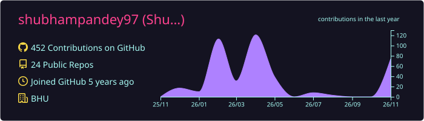
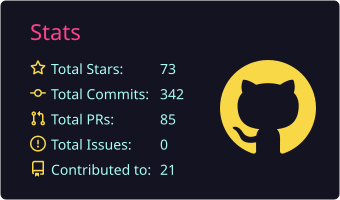
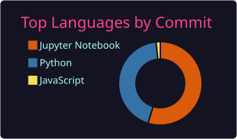

<!-- PROFILE HEADER -->
<h1 align="center">
  👋 Hi, I'm Shubham Pandey
</h1>

<h3 align="center">
  🤖 Machine Learning Engineer | 👁️ Computer Vision | 📏 Model Evaluation | 📚 RAG
</h3>

  

  
  
  

---

### 🧭 About Me

High scores are easy to report. I check whether they're real, then fix the data, the evaluation or the pipeline until they are.

- 💼 **2 years as a Software Developer** (Python, Django, FastAPI, PostgreSQL/Oracle): built a fintech company's first in-house reporting system, replacing manual Excel work.
- 🎓 **M.Sc. Data Science**, Banaras Hindu University · **B.Tech CSE**, SHUATS
- 🌱 Now building a **healthcare RAG system** with citations and measured retrieval quality.
- 📍 Varanasi · open to **Noida, Bengaluru or remote**

---

### 🔬 Flagship Projects

#### 🫁 [TB Detection from Chest X-rays: a case study in shortcut learning](https://github.com/shubhampandey97/tuberculosis-detection-v2)
> **0.998 AUC internally → 0.67 on two new hospitals.** The model had learned *where* the images came from, not TB.

- Fixed invalid metrics (train/eval preprocessing mismatch, validation reused as test).
- Proved shortcut learning: file metadata alone predicted the label (AUC 0.92); Grad-CAM focused outside the lungs.
- **Pre-registered** external validation on 800 X-rays (Shenzhen, Montgomery), then a shortcut-removal retrain that showed preprocessing alone can't fix it.
- `TensorFlow` `ResNet50` `Grad-CAM` `bootstrap CIs` `pytest (87)` `GitHub Actions` `Streamlit`

#### 🚗 [ANPR: Number-Plate Recognition, audited and rebuilt](https://github.com/shubhampandey97/number-plate-vehicle-detection)
> **98.5 % mAP was leakage.** 49 % of images were duplicate copies; 83–86 % of val/test had a near-twin in training.

- Rebuilt a deduplicated, scene-grouped split → honest test **mAP50 0.74** (YOLOv8s, 4× smaller than v8l).
- Measured plate reading for the first time (**0 / 37** correct), swapped in a plate-trained OCR + format checks + per-track voting → **71 %** of logged plates correct.
- Fixed a bug that re-created the tracker every frame → **9 / 9 plates** correct on a 4K traffic clip, no duplicates.
- `YOLOv8` `ByteTrack` `fast-plate-ocr` `OpenCV` `pytest (64)` `GitHub Actions` `Kaggle GPU`

#### 📚 [Healthcare RAG](https://github.com/shubhampandey97/healthcare-rag) *(in progress)*
> Cited answers from WHO immunisation and FDA/EU AI-device guidance, and a refusal when the sources don't cover the question.

- Found WHO papers are English/French two-column PDFs that leaked French into half the text; fixed with column detection + tests.
- Next: hybrid search (FAISS + BM25) with a reranker, a hand-written gold set for recall@k, then faithfulness and refusal evaluation.
- `PyMuPDF` `FAISS` `BM25` `cross-encoder` `Ollama` `FastAPI`

---

### 🧩 More Projects

| Project | Highlight | Tools |
|---|---|---|
| [📦 Amazon Delivery Time](https://github.com/shubhampandey97/amazon-delivery-prediction) | XGBoost **RMSE 22.3 min** vs 33.2 baseline; MLflow, SHAP | XGBoost, MLflow, Streamlit |
| [💰 Expense Manager](https://github.com/shubhampandey97/ExpenseManager) | JWT-auth REST API, Alembic migrations, SQL analytics, spend forecast | FastAPI, SQLAlchemy, MySQL |
| [💉 Global Vaccination Analysis](https://github.com/shubhampandey97/Vaccination-Analysis-Project) | WHO data → 5-table MySQL DB → 4 Power BI dashboards | Python, MySQL, Power BI |
| [🔎 NL Object Retrieval](https://github.com/shubhampandey97/npl-object-retrieval) | M.Sc. project: re-implemented SCRC (CVPR 2016) | PyTorch, VGG16, LSTM |
| [🎙️ Human Voice Classification](https://github.com/shubhampandey97/human_voice_project) | 48 audio features; SVM, neural net, clustering, SHAP | Scikit-learn, Keras |

---

### 🧰 Tech Toolbox

  

| | |
|---|---|
| **ML / DL** | PyTorch · TensorFlow/Keras · Scikit-learn · XGBoost · YOLOv8 · OpenCV |
| **Evaluation** | Bootstrap CIs · Calibration · External validation · Leakage & shortcut audits · SHAP · Grad-CAM |
| **LLM / RAG** | PyMuPDF · FAISS · BM25 · Ollama |
| **Engineering** | FastAPI · Django · SQL (PostgreSQL, Oracle, MySQL) · pytest · GitHub Actions · MLflow · Power BI |

---

### 🧾 Certifications
- 🎯 **Master Data Science**, IIT-M Pravartak / GUVI (HCL), 2025
- 🎯 **Advanced Programming**, IIT-M Pravartak, 2025

---

### 📊 GitHub Stats

  

  
  

---

  <b>⚡ “A model is only as good as its evaluation.” ⚡</b>

